# Architecture

> **Status:** Phase 1 final draft (P1.2), 2026-10-18. It was revised after an adversarial review (latency, R2, R4, tenancy) and waits for owner approval.
> Business numbers come from the working assumptions in `docs/BRIEF.md` (D-009).
> Interfaces marked **stable** change only through a decision entry.

## 1. Components and data flow

```
Customer phone ──PSTN──▶ SIP trunk (Yeastar or carrier) ──SIP──▶ LiveKit (room per call)
                                                                 │  ▲
                                customer track (SIP participant) │  │ agent mic track (WebRTC)
                                                                 ▼  │
 Agent app (Expo: iOS/Android/web) ◀── cards over data channel ── AI worker (Python, LiveKit Agents)
        │                                                          │
        │ Supabase Auth JWT                                        ├─ STT adapter (primary, backup)
        ▼                                                          ├─ end-of-turn model
 Supabase: Postgres + RLS, Auth, Storage, Edge Functions           ├─ playbook index (pgvector)
   ├─ livekit-token (mints room tokens, dispatches the worker,     ├─ model router → LLM adapters
   │   dials the customer)                                         │    (OpenAI-compatible: Groq, Gemini, …)
   ├─ escalation-email (outbox → email adapter)                    ├─ prompt registry
   └─ admin actions (audited)                                      └─ telemetry (card_timings)
```

| Component | Tech | Owns |
|---|---|---|
| Agent app | Expo SDK 58, expo-router, `@livekit/react-native` on native, `livekit-client` on web (D-010) | Calling UI, card rendering, history, admin screens |
| Media | LiveKit Cloud (one room per call) + LiveKit SIP | Separate tracks per participant (R4); data channel |
| Telephony | SIP trunk: the customer's Yeastar if it can trunk to LiveKit, otherwise a carrier (BRIEF `OPEN`) | PSTN in and out, caller ID |
| AI worker | Python 3.12+, LiveKit Agents, `apps/agent-worker` | The live path: STT → turn → trigger → playbook → suggest → card |
| Data | Supabase (Postgres 17 + RLS, Auth, Storage, Edge Functions) | Tenants, config, transcripts, cards, telemetry |
| Email, CRM | Adapters behind interfaces (Resend or Postmark; Zoho first) | Escalations, reminders, CRM links (async only) |
| Observability | `card_timings` table + Sentry (Phase 8) | R1 dashboard, alerts |

### One card, from customer speech to render

```mermaid
sequenceDiagram
    autonumber
    participant C as Customer (SIP track)
    participant W as AI worker
    participant S as STT adapter
    participant P as Playbook index
    participant R as Model router
    participant L as LLM adapter
    participant A as Agent app
    C->>W: audio frames (customer track only)
    W->>S: stream frames
    S-->>W: partial transcripts
    Note over W: on partials: trigger guess, playbook prefetch, speculative suggest request
    Note over W: t0 = VAD end of customer speech (minus measured ingress offset); R1 clock starts
    W->>W: end-of-turn model confirms the turn ended (~t0+250 ms)
    S-->>W: final transcript (+~100 ms)
    W->>P: lookup(final text, company) (100 ms timeout → treat as no hit)
    alt high-confidence playbook hit
        P-->>W: entry with short answer
        W-->>A: card delta 1 (source=playbook), no LLM needed
    else no hit or low confidence
        W->>R: resolve(stage=suggest, company)
        R->>L: stream(prompt from registry); usually already started on partials
        L-->>W: first token (backup started by t0+700 ms at the latest)
        W-->>A: card delta 1 (source=ai|backup, label)
    end
    W-->>A: further deltas, then done=true
    A->>A: render first delta (R1 "shown")
    W->>W: write card_timings row (async)
```

## 2. Interfaces (stable)

### Model router and adapters

The worker code lives in `apps/agent-worker/sotto_worker/`. ENGINEERING §4 has the Protocol signatures.

- `Stage` is one of `stt`, `turn`, `trigger`, `suggest`, `suggest_backup`, `summary`, `embed` or `judge`.
- `router.resolve(stage, company_id) -> StageRoute` returns:
  - `provider` (the adapter name);
  - `model`;
  - `settings`;
  - `first_token_ms` (the deadline);
  - `backup`, an optional `StageRoute`.

  Resolution order: the company's override (DB, Phase 6), then the platform default (`seed/models/default.yaml`).
- `router.stream(stage, request, company_id) -> AsyncIterator[LLMChunk]`:
  1. starts the primary;
  2. if no first chunk arrives by `first_token_ms`, measured as an **absolute deadline from t0** (backup started by t0+700 ms at the latest), starts the backup and takes whichever first chunk comes first (R2);
  3. cancels the loser and records the `fallback_reason`.

  More rules:
  - **Warm-up:** at call start, the router warms both the primary and the backup connections and prompt prefixes, so the backup is never cold when it is needed.
  - **Backup disabled:** a company may disable the backup per stage, including STT (R2). Then the primary keeps streaming until the holding deadline.
  - **Circuit breaker:** keyed by `(company_id, endpoint)`, so one company's bad key or dead local model never trips it for others.
  - **Company endpoints:** OpenAI-compatible URLs are checked against private and link-local IP ranges in the cloud deployment (SSRF).
  - **Live stages:** settings must disable or minimise model "thinking", so the first visible token is not delayed. Verify per model in P2.3.
- Every `LLMAdapter`/`STTAdapter` exposes `capabilities`: context size, prompt caching, JSON mode, and `benchmark` (last golden-set p95 per stage). The router refuses a live stage whose benchmark misses R1 (R6).
- Adapters are the only modules that import provider SDKs (`scripts/check-boundaries.sh`). `openai_compatible` takes a base URL + key + model, which covers Ollama, vLLM, LM Studio, Groq and OpenRouter.

### Prompt registry

- **Record (DB from Phase 6; seed files now):** `key`, `version`, `scope` (`platform | company | team | campaign`), `scope_id`, `stage`, `variables[]`, `body`, `status` (`draft | published | archived`), `created_by`, `created_at`.
- **Resolution:** `registry.get(key, ctx)` picks the published version with the most specific scope that matches the call: campaign → team → company → platform. Rollback re-publishes an older version (R6). There are no deletes.
- **Rendering:** `{{dotted.name}}` only, with no logic in templates. A missing variable raises an error before the model is called (failure F-11). The seed format and its validation are in `seed/prompts/README.md`.

### Card protocol

- The zod schema in `packages/shared/src/card.ts` is the single source.
- The JSON Schema `packages/shared/schema/card.v1.schema.json` is generated from it, and the pydantic model `sotto_worker/protocol/card.py` is generated from that.
- The fixtures in `packages/shared/fixtures/cards/` must be accepted or rejected the same way by both sides. CI fails on drift.
- Deltas share a `card_id`, are ordered by `seq`, and `done: true` closes the card.
- Every card carries the `turn_id` of the customer turn it answers. A later answer card with the same `turn_id` replaces that turn's holding card (§5); cards of other turns never do. The field is optional, so v1 stays compatible.
- The app dedupes on `(card_id, seq)` and drops unknown versions.

### Token minting (`supabase/functions/livekit-token`)

1. The app calls the function with the user's Supabase JWT and `{ phone_number | crm_contact_id, device_id }`.
2. The function checks, using the service role on the server only:
   - the user belongs to an active or trial company;
   - the user's role may call;
   - the device is not revoked;
   - the trial or plan allows minutes (R3).
   Any failure gives 403 with a reason code.
3. It creates the `calls` row and room `call_<call_id>`. It mints the rep token with a 10-minute TTL, one room and identity `rep_<user_id>` (never `agent_`, which LiveKit uses for worker participants). The grants are: join, publish microphone, subscribe. Data publish and `canUpdateOwnMetadata` are denied.
4. It dispatches the worker to the room (LiveKit agent dispatch) with metadata `{ call_id }`, plus a **per-call worker JWT**:
   - Its role is `worker`, with claims `company_id` and `call_id` and a TTL equal to the maximum call length.
   - The worker talks to Supabase with this token, never the service role, so RLS applies to every worker query.
   - The worker reads `company_id` from the `calls` row through this token and refuses the job if it does not match the token's claim.
5. It waits until the worker has joined the room (≤ 3 s, otherwise F-19), then creates the outbound SIP participant through the company's trunk. The SIP participant has identity `customer_<call_id>` and attribute `sotto.role=customer`, set server-side.
6. It returns `{ token, url, call_id }`.

The request must also pass these checks:
- **Company:** the request names `company_id`, and the caller must hold a membership in it, because a user may belong to several companies.
- **Device:** `device_id` is bound to the Supabase session (the `devices` row is keyed to the session), never trusted from the body.
- **Destination:** `phone_number` must match the company's destination allowlist (country codes). Calls are rate-limited per user and per company, against toll fraud.
- **CRM contact:** a `crm_contact_id` must belong to the caller's company.

Provider keys and the LiveKit secret never leave the server (CLAUDE.md, ENGINEERING §10).

**R4 enforcement:**
- The worker transcribes only the participant whose kind is SIP and whose attribute is `sotto.role=customer`.
- The agent track is transcribed only if the company enables context, and its events carry `speaker=agent`.
- The worker always runs VAD on the agent track (no transcription needed) for echo gating, below.
- Every stage that can lead to a card filters on `speaker == customer`:
  - drafting on partials;
  - end-of-turn;
  - trigger;
  - suggest.

  Each stage has its own unit test, and the replay checks it as the R4 acceptance test.
- **Echo:** a customer on speakerphone or in a car can send the agent's voice back down the SIP leg, labelled as the customer.
  - Customer segments that overlap agent VAD activity, delayed by up to 400 ms, are held back.
  - If agent context is on, the worker also drops a held segment whose text closely matches the agent's last 10 s.
  - The R4 replay includes echo fixtures (F-18).
- **Scope:** this design covers calls made through the app (R4 row 1). Desktop system-audio capture (row 2) and speakerphone/voice-sample mode (row 4) each need their own track path, and both are **deferred, not dropped**. They are designed by a decision before Phase 4 (P4.5). R4 itself is unchanged. Until then the app does not offer those modes.

## 3. Data model outline

Every table has:
- `id uuid`, `company_id uuid not null`, `created_at`;
- RLS on, with policies per role;
- a pgTAP isolation test (company A cannot select, insert, update or delete company B rows) in the PR that creates it.

There are three exceptions, the global tables listed last.

| Table | Purpose | Written by | Retention |
|---|---|---|---|
| `companies` | Tenant, plan state, settings (AI guesses on/off, agent context on/off, retention days, call goal, tone, holding-line text per language, destination allowlist) | platform owner, company admin (settings) | life of account + 30 days after expiry (R3) |
| `memberships` | user ↔ company, role (`company_admin`, `sales_manager`, `agent`), team | admin | same |
| `teams` | Team per company | admin | same |
| `devices` | Signed-in devices; `revoked_at` | auth flow, admin | same |
| `subscriptions` | Trial or plan, seats, minute limits, period | platform owner | same |
| `calls` | One per call: agent, customer ref, start/end, minutes, status | token function, worker | per company (default 13 months) |
| `transcript_segments` | Final STT segments with `speaker` | worker | company `transcript_retention_days` (default 90) |
| `cards` | Each card shown: type, source, text, playbook ref, agent feedback | worker, app (feedback) | 13 months |
| `card_timings` | One row per card: per-stage ms, total, provider, model, fallback reason (R1) | worker | 13 months, without transcript text |
| `playbook_entries` | Q/A, objection, product, never-promise; tags; `embedding vector` | admin, manager, escalation approval | life of account |
| `escalations` | Unanswered question, transcript excerpt, status `open / answered / added` (R2). Unique on `(call_id, question_hash)`, so each question escalates once. | worker, manager | 13 months |
| `prompt_versions` | Company, team and campaign scoped prompt versions (R6) | admin | forever (rollback) |
| `model_routes` | Company overrides of stage → provider/model/settings, and `backup_allowed` per stage (STT included, R2) | admin | forever |
| `provider_endpoints` | Company OpenAI-compatible endpoints; key encrypted (Vault) | admin | until removed |
| `feature_flags` | Per-company module switches | admin | same |
| `outbox` | Email and CRM jobs: status, attempts, dead letter | worker, functions | 30 days after done |
| `audit_log` | Every admin action: who, what, before, after (R3) | triggers / functions | 2 years |
| **Global** `plans` | Plan catalog | platform owner | – |
| **Global** `platform_prompt_versions` | Platform-scope prompts | platform owner | forever |
| **Global** `platform_model_routes` | Platform default routing (seeded from `seed/models/`) | platform owner | forever |

The worker reads and writes only through its per-call JWT (§2), so RLS applies. Isolation tests therefore also cover the `worker` role: a worker token for company A can neither read nor write company B rows. Global tables can be read by authenticated users and written only by the platform owner role. Their RLS tests cover that instead of company isolation. Audio is **not stored** by default (BRIEF). If a company enables recording, it goes to a private Storage bucket under `company_id/` with RLS and the same retention as transcripts.

## 4. Latency budget (R1)

**Clock.** t0 is the VAD end of customer speech on the customer track, corrected by the measured ingress offset (PSTN → SIP → LiveKit → worker). It is not the end-of-turn decision. `card_timings` stores `t0`, every stage's start and end relative to t0, and the ingress offset. "Shown" is the first delta rendered in the app (R1).

**Co-location rule:** the LiveKit SIP region, the worker region and the Supabase read path (a replica if needed) are the same region. Model providers are measured from that region in P2.3. The development region is chosen so these round trips stay inside the budget below.

| Stage | Budget (from t0) | Technique |
|---|---|---|
| Ingress: PSTN → SIP → LiveKit → worker | measured, ≤ 100 ms | Trunk lands in the worker's region; the offset is measured per trunk |
| End of turn | 250 ms | End-of-turn model, not fixed silence. Runs in parallel with the next three rows. |
| Final transcript | 100 ms | Streaming STT; the final arrives right after end of turn |
| Trigger classifier | 150 ms, overlapped | Rules first (question mark, objection lexicon). The LLM classifier runs on partials, so the final only confirms it. |
| Embed + playbook lookup | 50 ms + 50 ms, hard timeout 100 ms | Embeddings computed on partials; pgvector in-region; an in-memory top-FAQ cache per call; a timeout means "no hit" |
| Model first token | 450 ms | Request starts on partials (speculative draft) and is confirmed or cancelled at end of turn; warm connection; prompt cache on the stable prefix (company profile + playbook digest) |
| Data channel + render | 60 ms | First delta rendered immediately |
| **Total, primary path** | **~1010 ms target; 1500 ms hard p95** | |
| **Backup path** | Backup started by t0+700 at the latest. Pre-warmed first token ≤ 450 ms, plus 60 ms render, gives ≤ ~1210 ms. | Warm-up at call start (§2) |
| **Holding line** | Sent at t0+1400 so it renders before 1500 | Static text pre-rendered at call start from company settings. Never an LLM call. |

The P2.8 replay measures every row. A row that misses its budget is optimised or the plan changes, with numbers.

## 5. R2 fallback chain (per customer question)

```mermaid
stateDiagram-v2
    [*] --> Lookup: customer turn ends with a question/objection
    Lookup --> Playbook: high-confidence match
    Lookup --> Holding: no match and AI guesses disabled for company
    Lookup --> Primary: no match, AI guesses allowed
    Primary --> Verdict: first token by t0+700 ms
    Primary --> RaceBackup: no token by t0+700 ms, or error (backup allowed for this stage)
    Primary --> Holding: t0+1400 ms reached (backup disabled or both slow)
    RaceBackup --> Verdict: first token from either model
    RaceBackup --> Holding: both fail, or t0+1400 ms reached
    Verdict --> AIAnswer: leading verdict = ANSWER
    Verdict --> Holding: leading verdict = NO_SAFE_ANSWER
    Playbook --> [*]: card (source=playbook)
    AIAnswer --> [*]: card (source=ai|backup, label "Not in playbook — check before promising")
    Holding --> LateAnswer: an AI answer arrives by t0+5 s
    LateAnswer --> [*]: the answer card replaces the holding card; no escalation
    Holding --> Escalate: no answer by t0+5 s, or verdict NO_SAFE_ANSWER, or AI guesses disabled
    Escalate --> [*]: one escalation per (call_id, question_hash) + one manager email within 1 min
```



- **Verdict:** the suggest prompt makes the model start with a verdict token (`ANSWER` or `NO_SAFE_ANSWER`). The worker reads the verdict before it streams anything to the app, so the model can never stream half an answer and then retract it.
- **Exactly one email (R2 acceptance):**
  - the `escalations` row is unique on `(call_id, question_hash)`, so a repeated question or a reconnect resend cannot create a second one;
  - the outbox job uses the same key as the email provider's idempotency key;
  - the first send is immediate, and retries come at 10 s, 30 s, then 1, 5 and 15 min.

## 6. Failure modes

Each test is named so that the phase that builds the code writes it. "P2.x" means the test lands with that task.

| ID | Failure | Detection | What the agent sees | Recovery | Test that proves it |
|---|---|---|---|---|---|
| F-01 | Primary LLM slow or down | No first chunk by t0+700 ms, or an error or 5xx | Card from the backup (same look, `source=backup`); otherwise the holding line before 1500 ms | Router races the pre-warmed backup. A circuit breaker per `(company, endpoint)` skips the primary for 60 s after 3 failures in 30 s. | `test_router_races_backup_after_deadline`, `test_router_circuit_is_per_company_endpoint` (fake clock, P2.2); replay with the primary blocked (R2 acceptance, P2.8) |
| F-02 | STT primary down | Websocket error, or no partial for 2 s while customer audio energy is present | Small "transcription reconnecting" banner. Cards resume within ~2 s. | Switch to the backup STT vendor for the rest of the call (if the company allows it); retry the primary for the next call | `test_stt_failover_on_silence_with_energy` (fake STT, P2.5) |
| F-03 | Both STT vendors down | Both adapters failing | Banner "Suggestions paused: transcription unavailable". The call itself continues. | Keep retrying with backoff; alert (Phase 8) | `test_stt_total_outage_pauses_cards` (P2.6) |
| F-04 | No card by t0+1400 ms for any reason | Worker deadline timer (absolute from t0) | Holding line, rendered before 1500 ms (R2). An answer arriving by t0+5 s replaces it. | Escalation only if no answer by t0+5 s (§5) | `test_holding_card_at_deadline`, `test_late_answer_replaces_holding_without_escalation` (P2.6) |
| F-05 | LiveKit reconnect (agent network blip) | SDK `Reconnecting` / `Reconnected` events | "Reconnecting…" pill. Cards sent during the gap are re-sent from the worker's last 3 cards on `Reconnected`. | SDK resume; the worker replays recent cards; the app dedupes by `(card_id, seq)` | `test_worker_resends_recent_cards_on_rejoin` (P4.7); app dedupe unit test (P3.4) |
| F-06 | Agent offline mid-call (app killed, phone dead) | Agent participant leaves; no rejoin within 30 s | On return: "Call ended while you were away". The customer hears a brief tone before the call ends. | Worker ends the call after 30 s grace, closes the `calls` row and writes the summary job | `test_call_closes_after_agent_grace` (P4.7) |
| F-07 | DB unreachable during a call | Playbook lookup timeout 100 ms on the live path; 2 s elsewhere | Cards keep flowing: the per-call cache (company config, prompts, top FAQs loaded at call start) answers, and a lookup timeout falls through to the AI answer | Telemetry, transcript and escalation writes buffer in memory (bounded) and flush on recovery; dropped with a counter if the buffer fills | `test_live_path_survives_db_outage`, `test_lookup_timeout_falls_through` (P2.5); `test_telemetry_buffer_bounded` (P2.7) |
| F-08 | DB unreachable at call start | Token function or worker config load fails | "Can't start the call right now", with a retry button | No call is placed. This is safer than a call without tenant config. | Edge-function test `token_db_down_returns_503` (P4.2) |
| F-09 | Email provider down | Adapter error / non-2xx | Nothing on the call. The escalation shows "email pending" in the inbox. | Outbox retries with backoff (1, 5, 15, 60 min), then dead letter + admin alert; a backup provider if configured | `test_outbox_retries_then_dead_letters` (P7.1) |
| F-10 | CRM rate-limited (Zoho 429) | 429 or `Retry-After` | Nothing on the call. CRM fields fill in later. | Outbox honours `Retry-After`, with a token bucket per company; the live path never calls the CRM synchronously | `test_crm_429_respects_retry_after` (P7.3) |
| F-11 | Prompt render error (missing variable, bad template) | Registry raises before the model call | Card from the platform default prompt version, or the holding line | Falls back to the last published platform version; admin alert; prompt studio blocks publishing a template that fails render tests | `test_registry_falls_back_on_render_error` (P2.4); publish guard (P6.2) |
| F-12 | Local / self-hosted model too slow, or a company endpoint unreachable | Benchmark p95 for the stage > R1 budget; live first-token misses | The settings screen will not assign it to a live stage. If it degrades live, F-01 applies. | Router guard (R6); the backup handles live cards | `test_router_rejects_model_failing_r1_benchmark` (P2.2); `P6.4` UI test |
| F-13 | Duplicate worker joins the same room | On join, the worker sees another worker participant (LiveKit agent kind) with the same `call_id` dispatch metadata | Nothing (no double cards) | The worker with the lexically larger job ID leaves at once. The app dedupes by `card_id` anyway. | `test_second_worker_yields` (P4.4) |
| F-14 | Malformed or unknown-version card on the app | zod parse failure | Nothing: the card is dropped | Logged to Sentry with `call_id`, without payload text | `card.test.ts` invalid fixtures (exists); app drop test (P3.4) |
| F-15 | Trial or plan expires mid-call | Checked at call start only | The current call continues; the next call is blocked with the trial banner (R3) | – | `token_trial_expired_returns_403` (P5.5) |
| F-16 | SIP call fails to connect (busy, no answer, trunk down) | SIP participant error / status | "Couldn't reach the customer (busy / no answer / line error)" | The worker, already in the room (§2 step 5), leaves without doing any STT or LLM work; the `calls` row is closed with a reason; the trunk-down rate is alerted (Phase 8) | `test_sip_failure_closes_call` (P4.1/P4.4) |
| F-17 | Speakerphone / voice-sample mode (R4 row 4) | – | Deferred: not offered until a decision designs it (§2 scope). When it exists, the "approximate" badge is always shown. | – | Badge UI test when the mode is built |
| F-18 | Echo: the agent's voice comes back on the customer's SIP leg | Customer segment overlaps agent VAD (≤ 400 ms delay); with context on, also a text match against the agent's last 10 s | Nothing: no card from echoed speech | The segment is held back and dropped (§2 R4) | `test_echo_overlapping_agent_vad_is_dropped` (P2.5); echo fixtures in the R4 replay (P2.8) |
| F-19 | No worker joins, or the worker crashes mid-call | The token function waits ≤ 3 s for the worker before dialling. The app sees no worker heartbeat (data message every 2 s) for 5 s. | Before dialling: "Suggestions unavailable — call anyway?". Mid-call: banner "Suggestions offline, reconnecting". The call continues. | Re-dispatch once; the new worker loads the per-call cache and resumes; alert on repeated loss (Phase 8) | `token_waits_for_worker_then_dials` (P4.2); `test_worker_heartbeat` (P4.4); app banner test (P3.4) |

## 7. Cost per call minute (estimate)

These are public list prices found on 2026-10-18 and are approximate. Verify them before quoting to customers. All lines are per minute of call.

| Line | Assumption | $/min |
|---|---|---|
| LiveKit agent session | $0.01/min, list overage on the Ship/Scale plans | 0.010 |
| LiveKit SIP / telephony participant | Sources disagree: $0.003–0.01/min | 0.003–0.010 |
| LiveKit WebRTC participant (agent app) | Small; included or fractions of a cent | ~0.001 |
| STT, customer track + agent context (on by default, BRIEF) | Soniox real-time ~$0.12/h = $0.002/min. Speechmatics enhanced ~$0.40–0.56/h = $0.007–0.009/min. ×2 for both tracks. | 0.004–0.018 |
| LLM, live cards | ~4 turns/min × (3k input tokens, mostly cached, + 60 output) on a Haiku-class model at $0.10 / $0.50 per M tokens | ~0.002 |
| LLM + embeddings overhead | Speculative drafts on partials, trigger classifier, embeddings and warm-ups. Assume ×2 the live-card cost until P2.8 measures it. | ~0.002 |
| LLM, after-call summary | One larger-model call per call, spread over 5 min | ~0.002 |
| **Sotto platform cost, without the carrier** | | **≈ $0.02–0.05** |
| Carrier: outbound PSTN to UAE mobile | Twilio Elastic SIP list price, from $0.2955/min. A local carrier or the existing Yeastar trunk is likely far cheaper. | 0.00–0.30 |

**At the BRIEF numbers** (first company, 1,500 min/day, 22 days/month):
- the platform costs ≈ **$700–1,650/month**;
- the carrier adds up to **≈ $9,750/month** if calls go out through Twilio at UAE mobile list price.

**The carrier is the dominant cost.** Reusing the company's existing trunk (Yeastar) or a local carrier matters more than any model choice. That is why the Yeastar → LiveKit trunk question in BRIEF is the most valuable open item.

Sources:
- https://livekit.com/pricing
- https://docs.livekit.io/cloud/quotas-and-limits
- https://soniox.com/compare/stt/pricing
- https://www.twilio.com/en-us/sip-trunking/pricing/ae
- Claude Haiku 5.5 pricing as reported at launch (2026-10-07); confirm at https://docs.claude.com before relying on it.

## 8. Environments

- **local:** Supabase via Docker, LiveKit Cloud dev project, fake adapters by default.
- **dev cloud:** Supabase dev project, LiveKit dev project.
- **prod:** separate Supabase and LiveKit projects in the region chosen for data residency (BRIEF `OPEN`, before P8.4).

Secrets per environment are listed in ENGINEERING §5.
